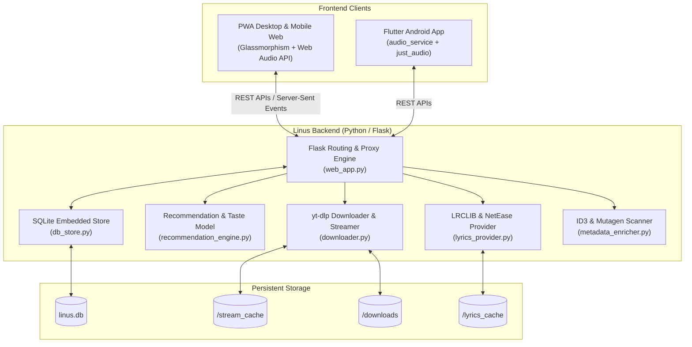

# 🎵 Linus Music Player — The Aesthetic Self-Hosted Listening Sanctuary

<div align="center">

[](https://www.python.org/)
[](https://flask.palletsprojects.com/)
[](https://flutter.dev/)
[](https://www.docker.com/)
[](https://web.dev/progressive-web-apps/)
[](LICENSE)
[](CONTRIBUTING.md)

<p align="center">
  <strong>Your private, high-fidelity music cloud. Seamlessly blends local audio libraries with online YouTube streaming, real-time synchronized karaoke lyrics, audiophile DSP effects, and intelligent mood-based discovery.</strong>
</p>

[Key Features](#-key-features) •
[Quick Start](#-quick-start) •
[Docker Deployment](#-docker-deployment) •
[Architecture](#-system-architecture) •
[Mobile App](#-flutter-android-companion) •
[API Reference](#-api-endpoints) •
[Shortcuts](#-keyboard-shortcuts) •
[Contributing](#-contributing)

</div>

---

## 🌟 Overview

**Linus** is an all-in-one, privacy-respecting, self-hosted music sanctuary built for audiophiles and casual listeners alike. Combining a responsive Glassmorphic web frontend, a robust Python/Flask media proxy engine, and a native Flutter companion app, Linus delivers a premium streaming experience that rivals commercial platforms like Spotify and Apple Music—with zero tracking, zero subscription fees, and complete ownership of your music.

Whether hosting on a local workstation, a home Raspberry Pi, or a remote VPS, Linus turns your personal storage into an intelligent, feature-packed listening hub.

```
                      ┌───────────────────────────────────────┐
                      │          Linus Music Player           │
                      │  "Where words fail, music speaks."    │
                      └──────────────────┬────────────────────┘
                                         │
        ┌────────────────────────────────┼────────────────────────────────┐
        ▼                                ▼                                ▼
  Local Library                   Online Discovery                  Studio & DSP
• Lossless FLAC/MP3/WAV        • YouTube Stream Proxy            • 8D Spatial Audio
• Automatic ID3 Tagging        • Lossless Media Downloads        • Vocal Remover / Karaoke
• Instant Fuzzy Search         • Smart YouTube Radio             • 10-Band EQ & Auto-DJ
```

---

## ⚡ Key Features

### 🎧 Audiophile DSP & Sound Engineering
* **8D 360° Spatial Audio:** Dynamic orbital binaural panning simulation that circles sound seamlessly around your headspace.
* **Real-time Karaoke & Vocal Suppression:** Mid-side phase cancellation DSP instantly isolates backing tracks for sing-alongs.
* **Auto-DJ Beat-Matched Crossfader:** Intelligent transition blending with automatic BPM estimation and equal-power smooth volume ramps.
* **10-Band Graphic Equalizer:** Studio-grade parametric bands with audiophile presets (Bass Boost, Acoustic, Vocal Clarity, Electronic, Flat).
* **Smart Gain Normalization:** Dynamic range compression and ReplayGain-style loudness leveling to avoid volume jolts across different tracks.

### 🌐 Hybrid Streaming & Media Downloader
* **Unified Music Catalog:** Browse local audio files and search YouTube’s worldwide catalog within a unified interface.
* **Multi-Format Media Downloader:** 1-click downloads for audio (`MP3`, `M4A`, `FLAC`, `OPUS`) and video (`MP4`, `WEBM`) from YouTube, SoundCloud, and Bandcamp.
* **Intelligent Stream Cache:** LRU disk cache for streamed tracks minimizes repeat bandwidth consumption and enables instant scrubbing.
* **YouTube Playlist Importer:** Import public or unlisted YouTube playlists directly into local smart playlists with batch metadata extraction.

### 🎤 Synchronized Lyrics & Linguistic Engine
* **Real-Time Karaoke Lyrics:** Synchronized line-by-line scrolling lyrics powered by LRCLIB and NetEase Cloud Music providers.
* **Romanized Pronunciation Support:** Automatic romanization guides for Japanese, Korean, Chinese, and international songs.
* **Interactive Lyric Scrubbing:** Click any lyric line to jump playback directly to that exact musical timestamp.
* **Built-in LRC Aligner & Editor:** Create, edit, and export custom time-synced `.lrc` lyric files directly in the browser.

### 🧠 Intelligent Recommendation & Taste Engine
* **Context-Aware Recommendations:** Self-learning recommendation model tracks play count, completions, and skips.
* **Circadian Mood Filter Chips:** Instantly filter your catalog into *Chill & Lo-Fi*, *High Energy*, *Focus & Flow*, *Late Night*, or *Discovery*.
* **2D Vibe Compass:** Interactive mood dial navigating Calming, Energetic, Melancholic, and Uplifting emotional spectrums.
* **Weekly Sound Rewind:** Spotify Wrapped-style interactive weekly listening recap, musical persona classification, and streak analytics.
* **Daily Listening Streak:** GitHub-style interactive calendar heatmap tracking listening consistency.

### 🎨 Atmospheric Theme Studio & Cinema Mode
* **6 Curated Atmospheric Vibes:** *Lo-Fi Cozy*, *Cyber Ecstatic*, *Sunset Sakura*, *Emerald Forest*, *Midnight Ocean*, and *Titanium Noir*.
* **Cozy Mode:** Transform your listening session with crackling vinyl fireplace ambiance and rain soundscapes.
* **Ambient Soundscape Mixer:** Layer gentle rain, ocean waves, autumn wind, and fireplace sounds with an integrated sleep timer.
* **Cinema Fullscreen Player:** 5 reactive visualizer modes (*Stage*, *Vinyl Record*, *Retro 90s Cassette*, *Breathing Halo*, *Clean Minimal*).
* **Universal Spotlight Search (`Ctrl + K`):** Lightning-fast command palette for instant track routing, DSP toggles, and view switching.

### 📱 Ecosystem & Privacy
* **Progressive Web App (PWA):** Installable on iOS, iPadOS, Android, macOS, and Windows with offline caching.
* **Linus Connect (Remote Control):** Real-time web socket sync across multiple browser tabs and devices.
* **Passcode PIN Protection:** Lock your private server behind an optional secure passcode overlay.
* **Discord Rich Presence:** Broadcast your currently playing tracks, album art, and timestamps directly to Discord.
* **Last.fm Scrobbler:** Native 2.0 API integration to scrobble tracks automatically in real-time.
* **Podcast RSS Feeds:** Subscribe to any podcast RSS XML feed with automatic chapter parsing and resume playback.

---

## 🏛 System Architecture



---

## 🚀 Quick Start

### Prerequisites
- **Python 3.10** or higher
- **FFmpeg** installed and accessible in your system `PATH` (required for yt-dlp audio extraction)
- A modern web browser (Chrome, Edge, Firefox, Safari)

### 1. Clone & Setup Environment

```bash
# Clone the repository
git clone https://github.com/Jayvirsinh270/yt-music.git
cd yt-music

# Create and activate virtual environment
# Windows (PowerShell):
python -m venv .venv
.\.venv\Scripts\Activate.ps1

# Linux / macOS:
python3 -m venv .venv
source .venv/bin/activate
```

### 2. Install Dependencies

```bash
python -m pip install --upgrade pip
pip install -r requirements.txt
```

### 3. Configure Environment

Copy the example environment template:

```bash
cp .env.example .env
```

Edit `.env` to customize your host, port, or YouTube cookie credentials if needed:

```ini
LINUS_HOST=127.0.0.1
LINUS_PORT=5000
STREAM_CACHE_MAX_MB=500
```

### 4. Launch Linus

```bash
python main.py
```

Open your browser and navigate to:
```text
http://127.0.0.1:5000
```

> **Tip (LAN Sharing):** Run `python main.py --lan` to automatically bind to `0.0.0.0` and broadcast access to any phone, tablet, or laptop on your local Wi-Fi.

---

## 🐳 Docker Deployment

Run Linus in an isolated container with persistent volumes for libraries, caches, and databases.

### Using Docker Compose (Recommended)

1. Review and adjust `docker-compose.yml` volume mounts:
```yaml
version: "3.9"

services:
  linus:
    build: .
    container_name: linus-music
    restart: unless-stopped
    ports:
      - "5000:5000"
    volumes:
      - ./downloads:/app/downloads
      - ./stream_cache:/app/stream_cache
      - ./lyrics_cache:/app/lyrics_cache
      - ./linus.db:/app/linus.db
      # Mount your local music folder:
      # - /path/to/your/music:/music:ro
    environment:
      - LINUS_HOST=0.0.0.0
      - LINUS_PORT=5000
```

2. Start the service:
```bash
docker-compose up -d
```

3. View live logs:
```bash
docker-compose logs -f
```

---

## 📱 Flutter Android Companion

Linus includes a native mobile client in the `mobile/` directory built with Flutter.

### Features
- Native background playback using Android foreground media notification controls
- Auto-sync with your self-hosted Linus server instance
- Local and remote offline playback
- Sleek modern UI inspired by Spotify and Apple Music

### Build & Run
```bash
cd mobile
flutter pub get
flutter run
```

---

## ⚙ Configuration Parameters

All settings can be customized via `.env` or system environment variables:

| Variable | Default | Description |
|:---|:---:|:---|
| `LINUS_HOST` | `127.0.0.1` | Network interface IP (`0.0.0.0` for all LAN interfaces) |
| `LINUS_PORT` | `5000` | HTTP port for the web server |
| `STREAM_CACHE_MAX_MB` | `500` | Maximum size in MB before LRU stream cache cleans older files |
| `YOUTUBE_COOKIE_FILE` | *None* | Path to Netscape-format `cookies.txt` for bot verification bypass |
| `YOUTUBE_COOKIES_BROWSER`| *None* | Auto-extract cookies from browser (`chrome`, `firefox`, `brave`, `edge`) |
| `LASTFM_API_KEY` | *None* | Last.fm developer API key for automatic scrobbling |
| `LASTFM_API_SECRET` | *None* | Last.fm developer API secret |

---

## 🔌 API Endpoints

Linus provides an extensive REST API that can be consumed by custom clients, scripts, and home automations:

### Playback & Streaming
- `GET /api/tracks` — Retrieve complete music catalog with metadata.
- `GET /media/<encoded_id>` — Stream local audio file with HTTP range request support.
- `GET /api/artwork/<encoded_id>` — Extract embedded ID3/FLAC cover artwork.
- `GET /api/youtube/stream/<video_id>` — Dynamic audio streaming proxy for YouTube tracks.
- `GET /api/youtube/search?q=<query>` — Query YouTube with instant fuzzy matches.

### Media Downloads
- `POST /api/download` — Queue a background download (supports YouTube, SoundCloud, Bandcamp).
- `GET /api/download/status/<job_id>` — Check progress and status of an active download task.
- `GET /api/download/progress/<job_id>` — Server-Sent Events (SSE) stream for live progress bars.

### Lyrics & Intelligence
- `GET /api/lyrics?title=<title>&artist=<artist>` — Fetch synchronized lyrics (`.lrc`).
- `POST /api/lyrics/save` — Save custom user-authored lyrics to a track.
- `GET /api/recommendations` — Fetch personalized mood, streak, and taste profiles.
- `GET /api/rewind` — Compute annual/weekly listening rewind metrics.

### Security & System
- `GET /api/auth/status` — Check server passcode requirement status.
- `POST /api/auth/login` — Authenticate session token via PIN.
- `GET /api/health` — Docker and monitoring health check endpoint.

---

## ⌨ Keyboard Shortcuts

Navigate and control playback instantly from anywhere in the app:

| Shortcut | Action |
|:---|:---|
| <kbd>Ctrl</kbd> + <kbd>K</kbd> / <kbd>Cmd</kbd> + <kbd>K</kbd> | Open Universal Spotlight Command Palette |
| <kbd>/</kbd> | Focus Universal Search |
| <kbd>Space</kbd> | Play / Pause playback |
| <kbd>M</kbd> | Mute / Unmute sound |
| <kbd>→</kbd> / <kbd>←</kbd> | Seek forward / backward 5 seconds |
| <kbd>Shift</kbd> + <kbd>→</kbd> / <kbd>Shift</kbd> + <kbd>←</kbd> | Skip to Next / Previous track in queue |
| <kbd>↑</kbd> / <kbd>↓</kbd> | Volume up / down (5% increments) |
| <kbd>N</kbd> / <kbd>P</kbd> | Next / Previous track |
| <kbd>S</kbd> | Toggle Shuffle mode |
| <kbd>R</kbd> | Cycle Repeat mode (Off / All / One) |
| <kbd>L</kbd> | Toggle Real-time Karaoke Lyrics view |
| <kbd>K</kbd> | Toggle Vocal Remover / Karaoke DSP mode |
| <kbd>D</kbd> | Toggle Auto-DJ Crossfader mode |
| <kbd>F</kbd> | Favorite current track / Toggle Fullscreen Player |
| <kbd>V</kbd> | Cycle Fullscreen Visualizer Mode |
| <kbd>1</kbd> – <kbd>5</kbd> | Direct visualizer mode switch (Stage, Vinyl, Retro, Halo, Clean) |
| <kbd>Esc</kbd> | Close active modals, Cinema HUD, or Sidebar |

---

## 🤝 Contributing

Contributions make the open-source community an inspiring place to learn, create, and build. Any contributions you make are **greatly appreciated**.

1. Fork the Project
2. Create your Feature Branch (`git checkout -b feature/AmazingFeature`)
3. Commit your Changes (`git commit -m 'feat: add AmazingFeature'`)
4. Push to the Branch (`git push origin feature/AmazingFeature`)
5. Open a Pull Request

Please refer to [CONTRIBUTING.md](CONTRIBUTING.md) for detailed code standards and architecture guidelines.

---

## 📄 License

Distributed under the MIT License. See [LICENSE](LICENSE) for more information.

---

<div align="center">
  <sub>Crafted with passion for music, privacy, and serene aesthetics.</sub>
</div>
